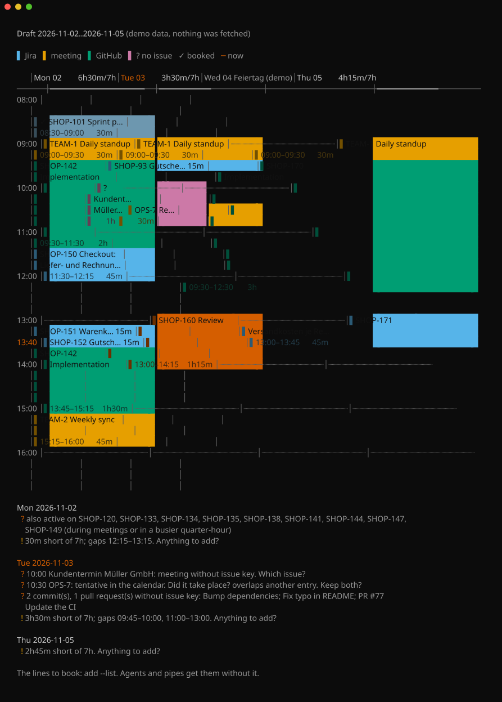

# Tempo Timesheet Drafter

[](https://github.com/countzero/tempo_timesheet_drafter/releases/latest) [](https://github.com/countzero/tempo_timesheet_drafter/commits/main) [](LICENSE) [](https://nodejs.org/en/download) [](https://github.com/sponsors/countzero) [](https://ko-fi.com/finnkumkar)

Drafts your [Tempo](https://www.tempo.io) timesheet from GitHub, your calendar and Jira, and books it after your approval.

<p align="center">
  
</p>

Open your coding agent in any project and say:

> Draft my Tempo bookings for today.

The agent drafts the day, describes the work from your commits and pull requests, asks about open points and books the lines only after you approve them. The drafter automates the following steps:

1. Reading your required hours and existing worklogs from Tempo
2. Collecting your commits, pull request reviews and comments, meetings and Jira activity with their time
3. Planning every day in quarter-hours and listing the open questions
4. Checking every approved line before booking it in Tempo

Unofficial; not affiliated with Tempo Software.

## Features

- Works as a skill for coding agents such as OpenCode or Claude Code, and in a terminal without one
- Understands ranges in English and German, e.g. `last-week` or `gestern`
- Reads your commits on every branch, so rebased commits stay on the day you wrote them
- Counts your pull request reviews and comments, not only your commits
- Places meetings at their exact time, on the issue key in their title
- Fills gaps of up to 45 minutes between pieces of work and leaves longer gaps open for breaks and absences
- Uses your last view of each Jira issue to fill quarter-hours without other activity
- Shows the week as a colored grid at a terminal, with issue keys linking to Jira
- Checks all lines before it books anything and is safe to run twice
- Easy configuration via one `.env` file
- No dependencies and no build: Node.js runs the TypeScript file directly

## Installation

### 1. Install Prerequisites

Download and install the latest versions of:

1. [Git](https://git-scm.com/downloads)
2. [Node.js](https://nodejs.org/en/download) 24.2 or newer
3. A coding agent such as [OpenCode](https://opencode.ai) or Claude Code (optional)

You also need a Jira Cloud site with Tempo Timesheets and a GitHub account that can read your repositories.

### 2. Clone the repository from GitHub

Clone the repository to a nice place on your machine and change into it via:

```PowerShell
git clone https://github.com/countzero/tempo_timesheet_drafter.git
Set-Location tempo_timesheet_drafter
```

### 3. Create a .env file

Create the following `.env` file in the project directory. Make sure to fill in the tokens and change `ATLASSIAN_SITE`, `ATLASSIAN_EMAIL` and `GITHUB_OWNERS`. Variables set in the environment take precedence over the file. `draft` needs every variable except `CALENDAR_ICS_URL`; `book` only needs the Tempo and Atlassian ones.

```dotenv
#
# Tempo API token.
#
# Tempo › Settings › Data Access › API Integration › New Token › Custom access:
#
#     worklogs : Manage (book creates worklogs, View is not enough)
#     schemes  : View   (required hours and holidays)
#
# Select nothing else.
#
TEMPO_API_TOKEN=

#
# Your Jira site, your Atlassian email and an API token without scopes
# ("Create API token", not "Create API token with scopes").
#
# @see https://id.atlassian.com/manage-profile/security/api-tokens
#
ATLASSIAN_SITE=https://example.atlassian.net
ATLASSIAN_EMAIL=jane.doe@example.com
ATLASSIAN_API_TOKEN=

#
# GitHub token that can read the repositories and their pull requests.
#
#     classic      : scope repo
#     fine-grained : Contents: Read and Pull requests: Read
#
# Hint: A fine-grained token covers a single owner, so for several
# organizations use a classic token. In an organization with SAML
# single sign-on, authorize a classic token via Configure SSO › Authorize;
# a fine-grained token is authorized when you create it.
#
# @see https://github.com/settings/tokens
#
GITHUB_TOKEN=

#
# Comma separated list of GitHub organizations or users whose
# repositories count. An entry can also be a single repository:
#
#     example-org
#     example-org,jane-doe
#     example-org/example-repo
#
GITHUB_OWNERS=example-org

#
# Private iCal link of your calendar (optional).
#
# Without it, drafts contain no meetings.
#
#     Outlook : Settings › Calendar › Shared calendars › Publish a calendar › "Can view all details"
#     Google  : Settings › your calendar › Integrate calendar › Secret address in iCal format
#
# Hint: Your organization may have disabled publishing in Outlook or
# limited it to free/busy. By default, the Outlook link covers three
# months back.
#
CALENDAR_ICS_URL=
```

> [!CAUTION]
> Treat the calendar link like a password: anyone who has it can read your calendar.

### 4. Install the agent skill

Link the repository into your personal skill directory, so your coding agent finds the skill in every project:

```PowerShell
New-Item -ItemType Directory -Force "$HOME\.claude\skills"
New-Item -ItemType Junction -Path "$HOME\.claude\skills\tempo_timesheet_drafter" -Target "$PWD"
```

On Linux and macOS:

```sh
mkdir -p ~/.claude/skills
ln -s "$PWD" ~/.claude/skills/tempo_timesheet_drafter
```

Claude Code reads personal skills from `~/.claude/skills`; OpenCode reads them from there and from `~/.agents/skills`.

### 5. Verify the setup

Show the commands, ranges and which variables are set:

```PowerShell
node .
```

Show a made-up week, without `.env` and without any API call:

```PowerShell
node . demo
```

Then open your coding agent in any project and say "Draft my Tempo bookings for today."

## Usage

> [!TIP]
> Draft soon after the day: Jira keeps only your latest view of each issue, so opening an issue again later moves its view to that day.

### Draft and book with your agent

Ask your agent in any project, for example:

| Request                            | Drafted range |
| ---------------------------------- | ------------- |
| Draft my Tempo bookings for today. | `today`       |
| Log my time for last week.         | `last-week`   |
| Buch mir gestern.                  | `yesterday`   |
| Zeiten für KW45 erfassen.          | `kw45`        |

The agent then:

1. Drafts the range and describes the work from your commits and pull requests
2. Checks the lines with `book --dry-run`
3. Shows you the complete list and asks about every open point
4. Applies your corrections and shows the list again
5. Books the lines only after you approve them, e.g. with "book", "buchen" or "passt"
6. Reports which lines were booked or skipped

### Draft in a terminal

Show this week as a colored grid, one block per worklog, with the open questions below it:

```PowerShell
node . draft week
```

Show the same week as draft lines:

```PowerShell
node . draft week --list
```

Write the draft lines of yesterday into a file to edit them:

```PowerShell
node . draft yesterday > draft.txt
```

Redirected, piped or run by a coding agent, `draft` always prints the draft lines, one per worklog. While fetching, a line on stderr shows each source (`…` running, `✓` done, `✗` failed) and then leaves one line with what each source brought and how long it took.

Run it from another directory with the path of the project directory instead of `.`:

```PowerShell
node D:\path\to\tempo_timesheet_drafter draft today
```

The following ranges are supported:

| Range                    | German         | Days                        |
| ------------------------ | -------------- | --------------------------- |
| `today` or `day`         | `heute`        | Today                       |
| `yesterday`              | `gestern`      | Yesterday                   |
| `week`                   | `woche`        | This week, Monday to Sunday |
| `last-week`              | `letzte-woche` | Last week                   |
| `kw45`                   |                | Calendar week 45            |
| `2026-11-03`             |                | A specific day              |
| `2026-11-02..2026-11-04` |                | A specific range of days    |

Days after today are left out.

### Review the draft

A draft of one day looks like this:

```text
# ── Tue 2026-11-03 ────────────────────────────────────── 3h30m / 7h ──
#
     2026-11-03 09:00   30m  TEAM-1    Daily standup
     2026-11-03 09:30   15m  SHOP-93   Gutscheine im Checkout einlösen
     2026-11-03 10:00    1h  ?         Kundentermin Müller GmbH
     2026-11-03 10:30   30m  OPS-7     Release 2.4 deployment
     2026-11-03 13:00 1h15m  SHOP-160  Review
#
#  ? 10:00 Kundentermin Müller GmbH: meeting without issue key. Which issue?
#  ? 10:30 OPS-7: tentative in the calendar. Did it take place? overlaps another entry. Keep both?
#  ? 2 commit(s), 1 pull request(s) without issue key: Bump dependencies; Fix typo in README; PR #77 Update the CI
#  ! 3h30m short of 7h; gaps 09:45–10:00, 11:00–13:00. Anything to add?
#  · batch: 09:41 SHOP-93 for resolution, status of SHOP-90, SHOP-91, SHOP-92, SHOP-93, SHOP-94, SHOP-95, SHOP-96, SHOP-97, SHOP-98
#  · calendar: 09:00 TEAM-1, 10:00 ?, 10:30 OPS-7
#  · SHOP-160: PR #318 Show the delivery date in the cart; Merge pull request #318 from shop/issue/SHOP-160
```

Every line without `#` is a booking: `YYYY-MM-DD HH:MM <duration> <ISSUE-KEY> <description>`, with durations such as `15m`, `1h` or `1h15m`. The description runs to the end of the line. Lines with `#` are comments, and their marks mean:

| Mark | Meaning                                                                                        |
| ---- | ---------------------------------------------------------------------------------------------- |
| `✓`  | A worklog that is booked in Tempo already                                                      |
| `?`  | A question, e.g. a meeting without issue key, a tentative meeting or commits without issue key |
| `!`  | The hours short of the required hours, with the open gaps                                      |
| `·`  | Where the lines come from: meetings, batch changes, views, commit subjects and pull requests   |

Replace each `?` in the issue column with an issue key or delete the line.

### Book the draft

Check every line and show what would be booked, without booking anything:

```PowerShell
node . book --dry-run draft.txt
```

Book the lines in Tempo:

```PowerShell
node . book draft.txt
```

Without a file, `book` reads the lines from stdin. It checks all lines first and books nothing if a line:

- has `?` instead of an issue key
- names an issue that does not exist
- has an impossible date, time or duration
- lies in the future

It then lists the problems with their line numbers. A line identical to an existing worklog (issue, date, start, duration) or to an earlier line is skipped, so running `book` twice is safe; a line whose start or duration you changed counts as new. Overlaps are reported before booking and booked anyway. Finally, `book` prints the Tempo worklog id of each line and each day's total against the required hours.

### Draft and book in one go

Check the draft of today without saving it:

```PowerShell
node . draft day | node . book --dry-run
```

Book the draft of today directly:

```PowerShell
node . draft day | node . book
```

> [!WARNING]
> The pipe books without your review: commit and pull request lines keep `Implementation` and `Review` as description, and tentative or overlapping meetings are booked as drafted. A `?` instead of an issue stops the run. Otherwise use the file or the agent.

## How it works

`draft <range>` reads your required hours and existing worklogs from Tempo, then plans every day from three sources:

| Source   | Provides                                                                                                                                            |
| -------- | --------------------------------------------------------------------------------------------------------------------------------------------------- |
| GitHub   | Your commits on every branch with commits in the range, in the repositories of `GITHUB_OWNERS`; your merges; your pull request reviews and comments |
| Calendar | Meetings with their time and length (optional)                                                                                                      |
| Jira     | Issues you created, changed or commented on; the last time you opened each issue                                                                    |

1. Hours already booked stay as they are. Every day is drafted, also one whose required hours are booked already, a weekend or a holiday: the required hours never limit what you worked.
2. Meetings are placed at their exact time, on the issue key in their title. A meeting without a key gets `?` instead of an issue. Meetings that overlap a worklog, or whose issue has a worklog that day, are left out, as are cancelled, free, out-of-office and all-day events, and declined ones where the feed records your answer. Tentative and overlapping meetings get a question.
3. Every quarter-hour with activity goes to the issue with the most activity in it. A commit or a pull request comment weighs most, then a merge, then a Jira change or a submitted review. A comment counts when you wrote it (an inline comment while the review was still pending), a review when you submitted it; a reply in a review thread counts as a comment. Activity during a meeting or a worklog belongs to it. Jira changes to one issue within a minute count once.
4. The same change to three or more issues, each within a minute of the previous (closing, estimating, linking), counts once: for their common parent, else for the issue of the batch you opened first around it, else for the one changed first. The day's `· batch:` line lists the issues of the batch to swap to.
5. A gap of up to 45 minutes between two pieces of work goes to the issue after it, since work leads up to the commit or change that records it. Longer gaps and the time before the day's first work stay open: they may be breaks or absences, so the draft does not fill a day to the required hours.
6. A quarter-hour still open in which you last opened an issue goes to that issue, and so do the open quarter-hours after it, up to 45 minutes: reading an issue leads into work on it. An issue opened in the last five minutes of a quarter-hour taken by a meeting or worklog counts for the next one. Three or more issues opened within a minute of each other (a list) do not count. The day's `· viewed:` line lists the quarter-hours filled this way.
7. An issue with commits, merges of other branches, or reviews and comments on your own pull request is described as `Implementation`; one with only pull request merges and reviews and comments on other pull requests as `Review`; one with only Jira activity or views by its summary.

Only keys of existing Jira projects count, so `UTF-8` in a commit message is not an issue. The day of a commit is its authored date, so rebased commits stay on their day. The issue of a review or comment comes from the pull request's branch name (also `feature/shop-12_checkout`), else from its title; a pull request merge takes it from the first line of the merge commit, in capitals. Comments posted with your account by automation count as yours. GitHub's search index can lag behind, so a review submitted just now may show up only in a later draft.

## Reference

### Commands

| Command                                 | Description                              |
| --------------------------------------- | ---------------------------------------- |
| `node . draft <range> [--grid\|--list]` | Draft worklogs, read-only                |
| `node . book [--dry-run] [<file>]`      | Book draft lines from a file or stdin    |
| `node . demo [--grid\|--list]`          | Show a made-up week, without API calls   |
| `node . help [<command>]`               | Show the help, or the help for a command |

### Exit codes

| Code | Meaning                                                      |
| ---- | ------------------------------------------------------------ |
| `0`  | Success                                                      |
| `1`  | Failure, or lines rejected by `book` (also with `--dry-run`) |
| `2`  | Usage error                                                  |

### Output variables

| Variable            | Effect                                             |
| ------------------- | -------------------------------------------------- |
| `NO_COLOR`          | Turns colors off, keeps bold                       |
| `FORCE_COLOR`       | Colors the draft lines in a pipe such as `less -R` |
| `FORCE_HYPERLINK=0` | Turns the links from issue keys to Jira off        |

Wherever colors are shown, issue keys link to the issue in Jira (Ctrl+click in Windows Terminal and VS Code), except in `demo`.

## Update

Pull the latest version in the project directory:

```PowerShell
git pull
```

The skill link points to the repository, so your agent uses the new version right away.

## Privacy

Everything runs locally and talks only to Tempo, your Jira site, GitHub and your calendar. Tokens and the calendar link stay in `.env`, which Git ignores. Used through a coding agent, the draft (commit subjects, meeting titles, issue summaries) also goes to your agent's model provider.

## License

MIT, see [LICENSE](./LICENSE).

## Support

If the drafter saves you time, consider supporting future work:

- [GitHub Sponsors](https://github.com/sponsors/countzero): recurring or one-time.
- [Ko-fi](https://ko-fi.com/finnkumkar): one-time tip, no signup required.

<a href="https://ko-fi.com/finnkumkar"></a>
